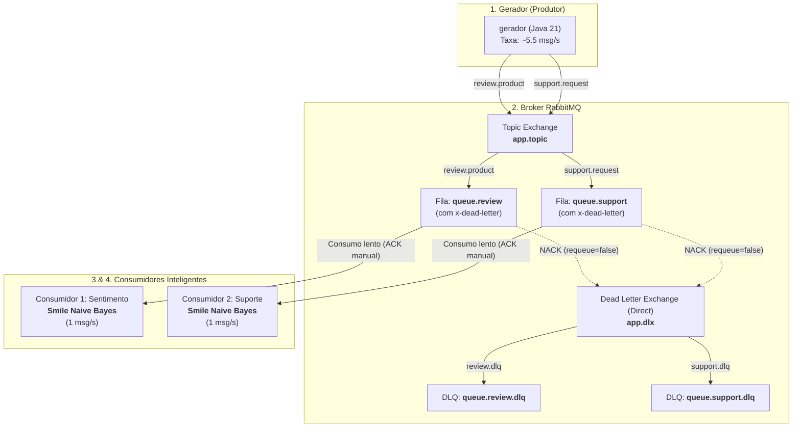

# Sistema Distribuído de Classificação Inteligente de Mensagens com RabbitMQ

Este repositório contém a implementação de um sistema distribuído para geração, distribuição e classificação inteligente de mensagens utilizando **Java 21**, **Docker**, **RabbitMQ** e **Inteligência Artificial (Smile ML)**.

O sistema é composto por 4 containers interdependentes operando em uma rede customizada Docker do tipo *bridge*.

---

## 🏗️ 1. Arquitetura do Sistema

A arquitetura adota o padrão orientado a eventos (*Event-Driven Architecture*) com broker de mensageria **RabbitMQ** e processamento assíncrono.



### Componentes:
1. **`rabbitmq`**: Broker RabbitMQ 3 com interface de gerenciamento (`15672`) e porta AMQP (`5672`).
2. **`gerador`**: Produz continuamente ~5,55 mensagens por segundo (intervalo de 180ms), alternando aleatoriamente entre avaliações de produtos e chamados de suporte.
3. **`consumidor-sentimento`**: Fila vinculada à routing key `review.product`. Classifica o sentimento em tempo real via IA embarcada.
4. **`consumidor-suporte`**: Fila vinculada à routing key `support.request`. Classifica a categoria técnica em tempo real via IA embarcada.

---

## 🧠 2. Mecanismo das IAs (Smile Machine Learning)

Ambos os consumidores utilizam a biblioteca [Smile Core](https://github.com/haifengl/smile) (`com.github.haifengl:smile-core`) para aprendizado de máquina supervisionado embarcado.

- **Algoritmo:** **Multinomial Discrete Naive Bayes** (`smile.classification.DiscreteNaiveBayes`).
- **Técnica de NLP:** Vetorização *Bag-of-Words* com tokenização e normalização textual (remoção de caracteres especiais e *lowercasing*).
- **Treinamento:** Executado dinamicamente em memória durante a inicialização do container.

### Categorias de Classificação:
| Serviço | Algoritmo | Classes de Saída |
| :--- | :--- | :--- |
| **Consumidor 1** | Naive Bayes Multinomial | `Positivo`, `Negativo`, `Neutro` |
| **Consumidor 2** | Naive Bayes Multinomial | `Problema de acesso`, `Problema de desempenho`, `Problema de conexão` |

---

## 🛡️ 3. Resiliência, Concorrência e DLQ (Dead Letter Queue)

- **Manual ACK (`autoAck = false`):** Cada mensagem só é confirmada no broker após o processamento bem-sucedido (`channel.basicAck`).
- **QoS Prefetch (`basicQos(1)`):** Cada consumidor processa estritamente 1 mensagem por vez.
- **Visualização do Crescimento de Fila:** O gerador envia ~5,5 msg/s enquanto os consumidores processam com `Thread.sleep(1000)` (~1 msg/s), permitindo observar o acúmulo das filas no painel do RabbitMQ.
- **Tratamento de Erro e DLQ:** Quando uma mensagem contém a palavra-chave `'ERRO_TESTE'` (ou causa falha), o consumidor aciona uma exceção e executa:
  ```java
  channel.basicNack(deliveryTag, false, false); // requeue = false
  ```
  O RabbitMQ rejeita a mensagem e a transfere automaticamente para o Dead Letter Exchange (`app.dlx`) e para a respectiva DLQ (`queue.review.dlq` ou `queue.support.dlq`).

---

## 🚀 4. Como Executar o Sistema

### Pré-requisitos
- [Docker Engine](https://docs.docker.com/engine/install/) e [Docker Compose](https://docs.docker.com/compose/) instalados.

### Inicialização
Para construir as imagens e subir os 4 containers:
```bash
docker compose up -d --build
```

Para verificar o status dos containers:
```bash
docker compose ps
```

### Acompanhamento dos Logs
- **Log do Gerador:**
  ```bash
  docker logs -f gerador
  ```
- **Log do Consumidor 1 (Análise de Sentimento):**
  ```bash
  docker logs -f consumidor-sentimento
  ```
- **Log do Consumidor 2 (Classificação de Suporte):**
  ```bash
  docker logs -f consumidor-suporte
  ```

### Interface Administrativa do RabbitMQ
- Acesse no navegador: [http://localhost:15672](http://localhost:15672)
- **Usuário:** `guest`
- **Senha:** `guest`

---

## 🧪 5. Roteiro para a Demonstração em Vídeo (+- 5 minutos)

Durante a gravação da apresentação, demonstre os 5 pontos exigidos pelo trabalho:

1. **Geração Contínua de Mensagens:**
   - Mostre o terminal executando `docker logs -f gerador`.
   - Destaque o envio com mais de 5 mensagens por segundo e as estatísticas periódicas.
2. **Encaminhamento pelo Topic Exchange:**
   - No painel Web do RabbitMQ (`Exchanges > app.topic`), mostre os bindings para as routing keys `review.product` e `support.request`.
3. **Classificação em Tempo Real pelas duas IAs:**
   - Divida a tela e exiba os logs dos dois consumidores:
     - `docker logs -f consumidor-sentimento` exibindo: `Mensagem: [...] - Classificação: [Positivo/Negativo/Neutro]`.
     - `docker logs -f consumidor-suporte` exibindo: `Mensagem: [...] - Classificação: [Problema de acesso/desempenho/conexão]`.
4. **Crescimento das Filas:**
   - No painel Web do RabbitMQ (`Queues`), mostre a coluna *Total* crescendo continuamente nas filas `queue.review` e `queue.support` devido ao consumo mais lento (1000ms vs 180ms).
5. **Tratamento de Mensagem com Erro via DLQ:**
   - Execute o script facilitador de teste:
     ```bash
     ./test-dlq.sh
     ```
   - Nos logs do consumidor, mostre a captura da exceção `'ERRO_TESTE'` e a emissão do `NACK`.
   - Na interface do RabbitMQ, mostre as mensagens chegando com sucesso nas filas `queue.review.dlq` e `queue.support.dlq`.

---

## 📸 6. Evidências de Execução

*(Adicione suas capturas de tela nesta seção ou na pasta `docs/screenshots/`)*

| Evidência | Arquivo |
| :--- | :--- |
| **Crescimento das Filas no RabbitMQ** | `docs/screenshots/filas-crescendo.png` |
| **Topic Exchange e Bindings** | `docs/screenshots/topic-exchange.png` |
| **Mensagens roteadas para a DLQ** | `docs/screenshots/dlq-mensagens.png` |
| **Execução das IAs nos Consumidores** | `docs/screenshots/logs-ia-classificacao.png` |

---

## 🛑 7. Finalização e Limpeza
Para parar todos os serviços e remover os containers:
```bash
docker compose down
```
Para limpar também o volume persistente do RabbitMQ:
```bash
docker compose down -v
```
