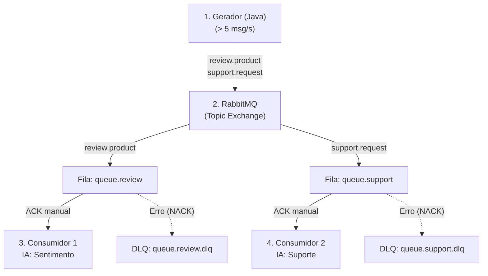

# Sistema Distribuído de Classificação de Mensagens com RabbitMQ

Este repositório contém a implementação de um sistema distribuído utilizando **Java**, **Docker**, **RabbitMQ** e **Inteligência Artificial** (biblioteca Smile). O sistema gera, distribui e classifica mensagens automaticamente em duas categorias independentes.

---

## 1. Arquitetura do Sistema

O sistema é composto por 4 containers em Docker conectados na mesma rede:



### Componentes:
- **RabbitMQ:** Broker de mensageria com interface de administração habilitada.
- **Gerador:** Cria e publica avaliações de produtos e solicitações de suporte continuamente (taxa mínima de 5 mensagens/segundo).
- **Consumidor 1 (Sentimentos):** Consome as mensagens de avaliações de produtos.
- **Consumidor 2 (Suporte):** Consome as solicitações de suporte técnico.

---

## 2. Classificação com IA (Smile)

Ambos os consumidores utilizam a biblioteca Smile para Java (`smile-core`) com o algoritmo Naive Bayes para classificar os textos recebidos em tempo real.

| Serviço | Domínio | Classificações Possíveis |
| :--- | :--- | :--- |
| **Consumidor 1** | Avaliações de Produtos | Positivo, Negativo, Neutro |
| **Consumidor 2** | Solicitações de Suporte | Problema de acesso, Problema de desempenho, Problema de conexão |

---

## 3. Regras Técnicas Implementadas

- **Topic Exchange:** O encaminhamento das mensagens é feito através das chaves de roteamento `review.product` e `support.request`.
- **Crescimento de Filas:** O gerador produz mensagens de forma mais rápida do que a taxa de processamento dos consumidores (atraso intencional adicionado), permitindo a visualização do crescimento das filas no RabbitMQ.
- **Manual ACK:** As mensagens apenas são confirmadas no RabbitMQ após o processamento com sucesso.
- **Dead Letter Queue (DLQ):** Mensagens que geram erro durante o processamento (ex: simulação com a palavra "ERRO_TESTE") sofrem NACK e são encaminhadas para uma fila de erros (DLQ), em vez de serem descartadas.

---

## 4. Instruções de Execução

**Pré-requisitos:** Docker e Docker Compose instalados.

1. Construa e inicie os serviços:
```bash
docker compose up -d --build
```

2. Acompanhe os logs dos consumidores no terminal:
```bash
docker logs -f consumidor-sentimento
docker logs -f consumidor-suporte
```

3. Acesse a interface do RabbitMQ no navegador:
- **URL:** [http://localhost:15672](http://localhost:15672)
- **Usuário / Senha:** `guest` / `guest`

4. Simular erro para envio à DLQ (opcional):
```bash
./test-dlq.sh
```

5. Para encerrar o sistema:
```bash
docker compose down -v
```

---

## 5. Evidências de Execução

### 5.1 Geração Contínua de Mensagens (> 5 msg/s)
Logs do gerador publicando continuamente no RabbitMQ:


### 5.2 Topic Exchange e Roteamento
Visão geral dos exchanges e bindings para as routing keys `review.product` e `support.request`:


### 5.3 Crescimento das Filas
Filas acumulando mensagens devido ao consumo mais lento:


### 5.4 Classificação com IA
Logs dos consumidores classificando as mensagens recebidas em tempo real:


### 5.5 Dead Letter Queue (DLQ)
Mensagens com erro direcionadas para as filas DLQ:


