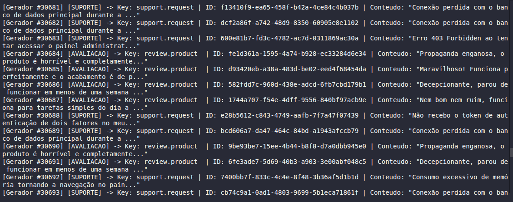
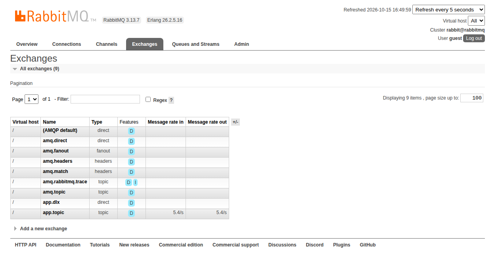
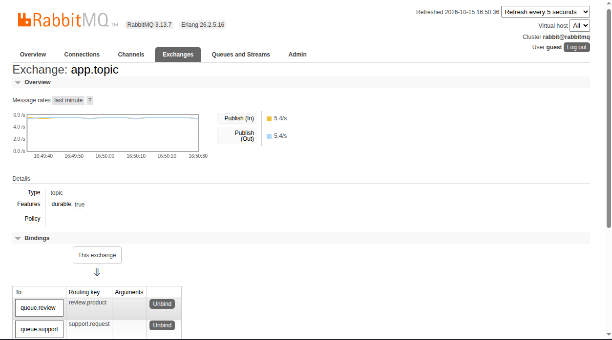
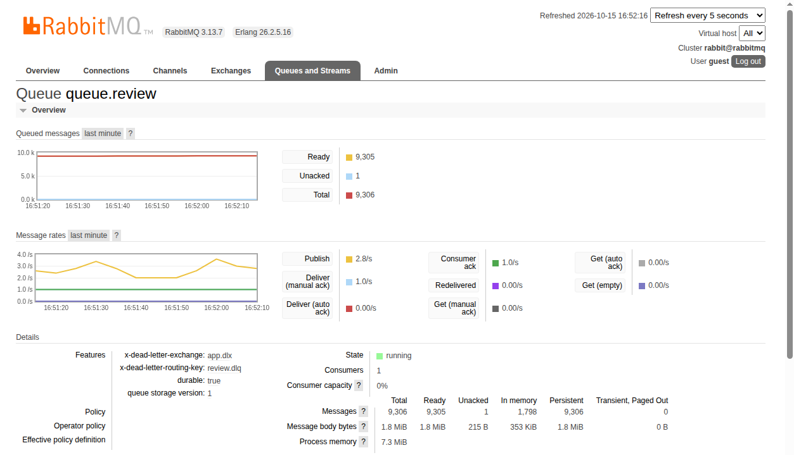
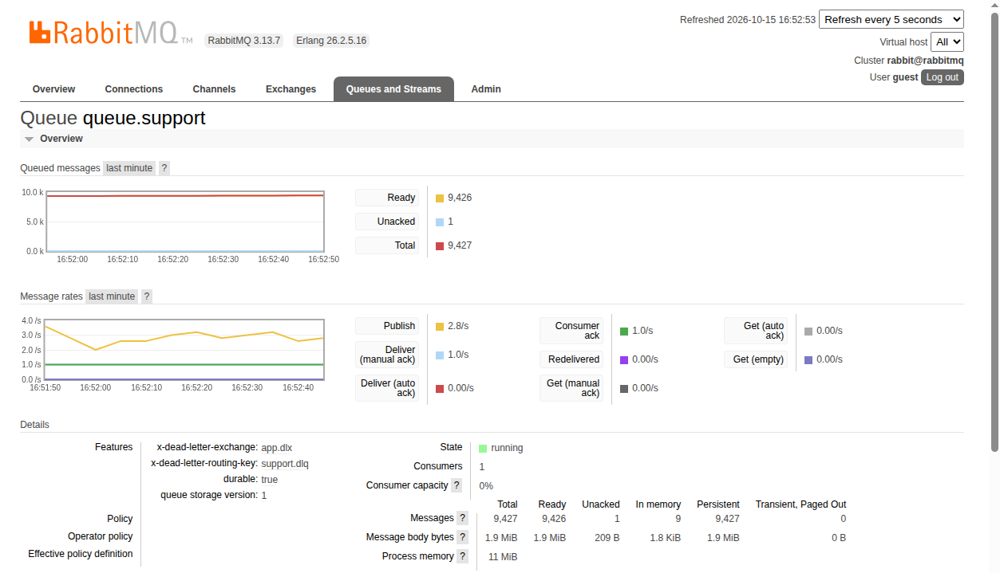
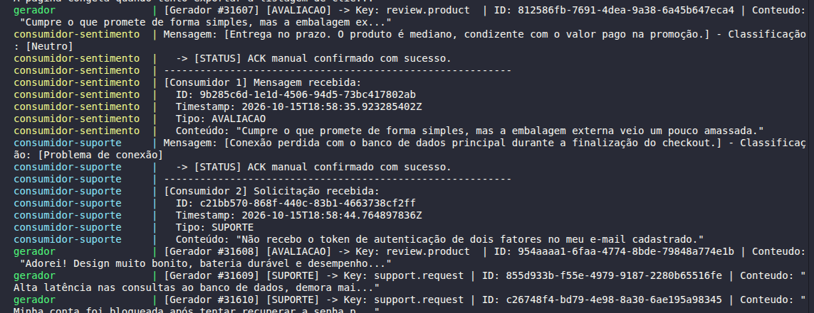
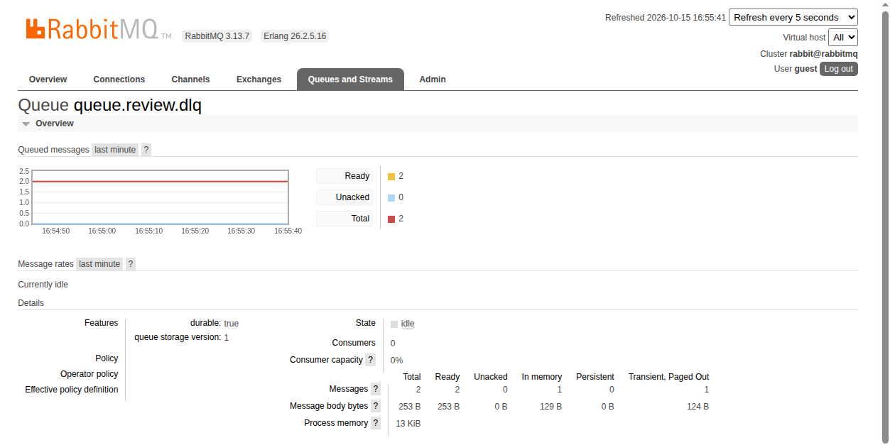
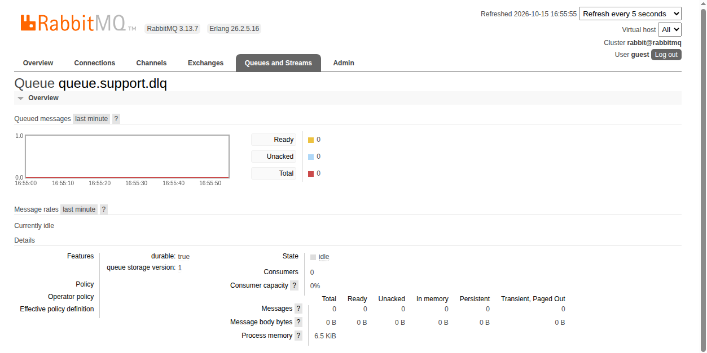

# Sistema Distribuído de Classificação de Mensagens com RabbitMQ

Trabalho prático da disciplina de Sistemas Distribuídos: desenvolvimento de um sistema distribuído para geração contínua, distribuição por tópicos e classificação de mensagens utilizando **Java 21**, **Docker Compose**, **RabbitMQ** e a biblioteca de inteligência artificial **Smile**.

---

## 1. Arquitetura do Sistema

O sistema é composto por 4 containers conectados em uma mesma rede Docker bridge (`rabbitmq-network`):

- **rabbitmq:** Broker RabbitMQ com a interface web de administração exposta na porta `15672` e porta AMQP `5672`.
- **gerador:** Serviço produtor em Java que gera continuamente pelo menos 5 mensagens por segundo (~5,5 msg/s). Publica em um Topic Exchange (`app.topic`) alternando entre avaliações de produtos (`review.product`) e chamados de suporte (`support.request`).
- **consumidor-sentimento:** Consome mensagens da fila `queue.review` e classifica o sentimento do texto em Positivo, Negativo ou Neutro.
- **consumidor-suporte:** Consome mensagens da fila `queue.support` e classifica o chamado técnico em Problema de acesso, Problema de desempenho ou Problema de conexão.
- **Dead Letter Queue (DLQ):** As filas possuem configuração de DLQ através do Dead Letter Exchange `app.dlx`. Mensagens com falha de processamento sofrem `basicNack` com `requeue=false` e são redirecionadas para `queue.review.dlq` e `queue.support.dlq`.

---

## 2. Inteligência Artificial com Smile

Os dois consumidores utilizam a biblioteca **Smile** (`com.github.haifengl:smile-core`) para aprendizado de máquina supervisionado embarcado.

- **Modelo:** `DiscreteNaiveBayes` (Multinomial).
- **Processamento de Texto:** Vetorização bag-of-words sobre o vocabulário das mensagens.
- **Treinamento:** Executado em memória na inicialização de cada consumidor com dados representativos.

| Serviço | Modelo | Classes |
| :--- | :--- | :--- |
| **Consumidor 1** | Naive Bayes Multinomial | `Positivo`, `Negativo`, `Neutro` |
| **Consumidor 2** | Naive Bayes Multinomial | `Problema de acesso`, `Problema de desempenho`, `Problema de conexão` |

---

## 3. Mensageria, Concorrência e DLQ

- **Confirmação Manual (Manual ACK):** O consumo não utiliza auto-ack (`autoAck = false`). A mensagem só é confirmada após o término do processamento (`basicAck`).
- **Controle de Concorrência (QoS):** Configurado `basicQos(1)` em ambos os consumidores.
- **Crescimento das Filas:** O gerador envia ~5,5 msg/s (intervalo de 180ms), enquanto os consumidores processam a ~1 msg/s (`Thread.sleep(1000)`), permitindo visualizar o acúmulo das mensagens no painel do RabbitMQ.
- **Tratamento de Erros:** Quando o texto da mensagem contém a palavra-chave `'ERRO_TESTE'`, o consumidor lança uma exceção e executa:
  ```java
  channel.basicNack(deliveryTag, false, false);
  ```
  O broker descarta a mensagem da fila principal e a envia diretamente para a Dead Letter Queue correspondente.

---

## 4. Instruções de Execução

### Pré-requisitos
- Docker e Docker Compose instalados.

### Subir os containers
```bash
docker compose up -d --build
```

### Verificar status
```bash
docker compose ps
```

### Visualizar logs
- **Gerador:**
  ```bash
  docker logs -f gerador
  ```
- **Consumidor 1 (Sentimento):**
  ```bash
  docker logs -f consumidor-sentimento
  ```
- **Consumidor 2 (Suporte):**
  ```bash
  docker logs -f consumidor-suporte
  ```

### Painel do RabbitMQ
- Acesse: [http://localhost:15672](http://localhost:15672)
- Usuário: `guest` | Senha: `guest`

---

## 5. Roteiro para o Vídeo de Demonstração (+- 5 minutos)

1. **Geração contínua:** Mostrar o terminal com `docker logs -f gerador` produzindo mensagens a > 5 msg/s.
2. **Topic Exchange:** Abrir o painel web em *Exchanges > app.topic* e mostrar os bindings para `review.product` e `support.request`.
3. **Classificação pelas IAs:** Exibir os logs dos dois consumidores classificando em tempo real.
4. **Crescimento das filas:** No painel web (*Queues*), mostrar o total de mensagens crescendo nas filas `queue.review` e `queue.support`.
5. **Tratamento de erro via DLQ:** Executar `./test-dlq.sh`, mostrar o `NACK` no log do consumidor e a mensagem chegando na fila DLQ (`queue.review.dlq`).

---

## 6. Evidências de Execução

### 6.1 Geração Contínua de Mensagens (> 5 msg/s)
O serviço **Gerador** publica continuamente mensagens alternadas nos tipos `AVALIACAO` e `SUPORTE`:


### 6.2 Topic Exchange e Roteamento
Visão geral dos exchanges e detalhe dos bindings do `app.topic` para as routing keys `review.product` e `support.request`:



### 6.3 Crescimento das Filas e Consumo Lento
Acúmulo de mensagens nas filas `queue.review` e `queue.support` com consumo lento e confirmação manual:



### 6.4 Classificação em Tempo Real pelas IAs
Logs dos consumidores classificando as mensagens via Smile Naive Bayes:


### 6.5 Tratamento de Erro e Dead Letter Queue (DLQ)
Mensagens direcionadas para a DLQ após rejeição com `basicNack`:



---

## 7. Finalização
Para parar os containers:
```bash
docker compose down
```
Para parar e limpar volumes:
```bash
docker compose down -v
```
